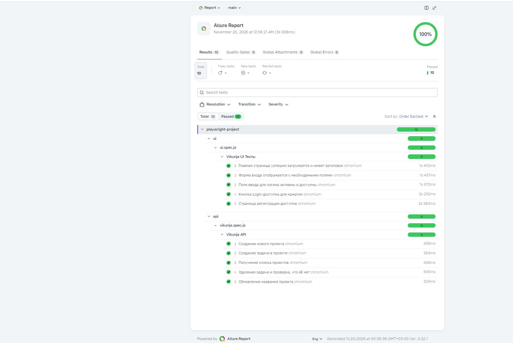
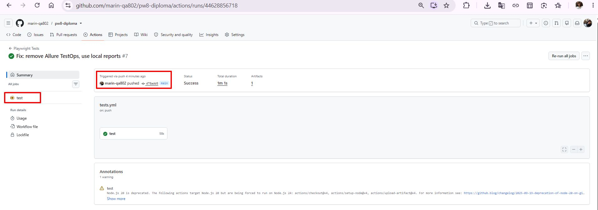

# Дипломный проект: Фреймворк для UI + API тестов (Vikunja)

Фреймворк для автоматизации тестирования веб-приложения Vikunja на Playwright.

## Стек
* JavaScript / Node.js
* Playwright
* Allure Reporter + Allure TestOps
* GitHub Actions (CI/CD)

## Установка и запуск

1. Клонируйте репозиторий:
   `git clone https://github.com/marin-qa802/pw8-diploma.git`
2. Установите зависимости:
   `npm install`
3. Установите браузеры Playwright:
   `npx playwright install`

4. Создайте файл `.env` в корне проекта и заполните его по образцу `.env.example`:
    ```env
    BASE_URL=https://try.vikunja.io
    VIKUNJA_USER=your_login
    VIKUNJA_PASSWORD=your_password
    ALLURE_ENDPOINT=https://allure.qa.guru
    ALLURE_TOKEN=your_allure_token
    ALLURE_PROJECT_ID=your_project_id
    ```


## Структура проекта

- `tests/ui/`, `tests/api/` — тесты (6 UI + 5 API)
- `src/pages/` — Page Object'ы
- `src/facade/` — фасад, тесты получают его из фикстуры
- `src/builders/` — билдеры тестовых данных (faker только здесь)
- `src/fixtures/` — фикстура с фасадом
- `src/services/` — API-клиент
- `.github/workflows/tests.yml` — CI: прогон, отправка в Allure TestOps, уведомление в Telegram


## Отчетность и уведомления

В проекте настроен CI/CD через GitHub Actions. После каждого пуша запускаются тесты.

### 1. Отчет Allure (100% Pass Rate)


### 2. Уведомление в Telegram
После завершения тестов бот присылает отчет:


### 3. Успешный прогон в GitHub Actions

